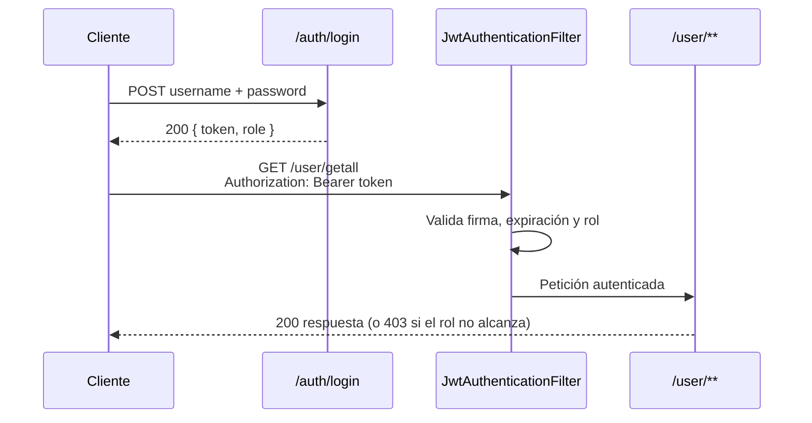

<div align="center">

# 🔐 SpringFirstApp JWT

**API REST con Spring Boot, autenticación JWT y control de acceso por roles**


</div>

---

## 📖 Descripción

Aplicación **Spring Boot** que demuestra autenticación y autorización con **JWT (JSON Web Token)**. Expone una API REST segura para registrar usuarios, iniciar sesión y gestionar usuarios según su rol (`USER` o `ADMIN`).

## ✨ Características

- 🔑 Inicio de sesión con **JWT** (HS256, validez de 24 horas)
- 🛡️ Autorización por **roles** (`USER` y `ADMIN`) con Spring Security
- 👥 **CRUD de usuarios** con variantes por parámetros y por JSON
- 🔒 Contraseñas cifradas con **BCrypt**
- 🌐 **CORS** configurado para clientes web
- 📚 Documentación interactiva con **Swagger UI** (OpenAPI)
- ⚠️ Manejo de excepciones propio (`PasswordNotValidException`)
- 🧪 Pruebas unitarias con JUnit y Spring Security Test
- 📝 Javadoc en español

## 🧰 Tecnologías

| Capa | Tecnología |
| --- | --- |
| Lenguaje | Java 21 |
| Framework | Spring Boot 3.4.5 (Web, Validation, Data JPA, Security) |
| Autenticación | JJWT 0.11.5 |
| Base de datos | MySQL (Hibernate / JPA) |
| Documentación | springdoc-openapi 2.3.0 (Swagger UI) |
| Utilidades | ModelMapper, Gson, Commons Codec |
| Build | Maven (incluye Maven Wrapper) |

## 🏗️ Arquitectura

```text
src/main/java/co/edu/unbosque/springfirstapp
├── configuration/   # Datos iniciales y configuración de OpenAPI
├── controller/      # AuthController, UserController
├── dto/             # UserDTO
├── exception/       # PasswordNotValidException
├── model/           # Entidad User y enum Role
├── repository/      # UserRepository (Spring Data JPA)
├── security/        # SecurityConfig, JwtUtil, JwtAuthenticationFilter
├── service/         # UserService y lógica de negocio
└── util/            # AESUtil
```

### Flujo de autenticación



## 🚀 Puesta en marcha

### Requisitos previos

- ☕ **Java 21** o superior
- 🐬 Un servidor **MySQL** accesible
- 📦 Maven (opcional: el proyecto incluye `mvnw`)

### 1. Clonar el repositorio

```bash
git clone https://github.com/P2X4A/SpringFirstAppJWT.git
cd SpringFirstAppJWT
```

### 2. Crear `application.properties`

> [!IMPORTANT]
> El archivo `src/main/resources/application.properties` **no está en el repositorio** (está en `.gitignore` porque contiene credenciales). Debes crearlo tú.

Crea `src/main/resources/application.properties` con este contenido y ajusta los valores:

```properties
# Base de datos
spring.datasource.url=jdbc:mysql://localhost:3306/springfirstapp?createDatabaseIfNotExist=true
spring.datasource.username=TU_USUARIO
spring.datasource.password=TU_PASSWORD
spring.datasource.driver-class-name=com.mysql.cj.jdbc.Driver
spring.jpa.hibernate.ddl-auto=update

# Servidor
server.port=8081

# JWT: usa un secreto propio de al menos 32 caracteres
jwt.secret=CAMBIA_ESTE_VALOR_POR_UN_SECRETO_LARGO_Y_ALEATORIO
```

> [!WARNING]
> Si no defines `jwt.secret`, la aplicación usa un valor por defecto que está escrito en el código fuente público. Defínelo siempre, sobre todo fuera de tu máquina local.

### 3. Ejecutar

```bash
./mvnw spring-boot:run
```

En Windows (PowerShell o CMD):

```bash
mvnw.cmd spring-boot:run
```

Al arrancar, la aplicación crea las tablas (`ddl-auto=update`) y, si no existen, un usuario administrador y uno normal de ejemplo (ver [`LoadDatabase.java`](src/main/java/co/edu/unbosque/springfirstapp/configuration/LoadDatabase.java)). Cambia esas credenciales antes de cualquier uso real.

## 📚 Documentación de la API

Con la aplicación en marcha, abre Swagger UI:

```text
http://localhost:8081/swagger-ui/index.html
```

La especificación OpenAPI en JSON está en `http://localhost:8081/v3/api-docs`.

## 🔑 Autenticación

### Registrarse

`POST /auth/register` es público y crea un usuario con rol `USER` (la contraseña debe tener al menos 8 caracteres).

```bash
curl -X POST http://localhost:8081/auth/register \
  -H "Content-Type: application/json" \
  -d '{"username": "nuevoUsuario", "password": "contraseña123"}'
```

### Iniciar sesión

```bash
curl -X POST http://localhost:8081/auth/login \
  -H "Content-Type: application/json" \
  -d '{"username": "nuevoUsuario", "password": "contraseña123"}'
```

Respuesta:

```json
{
  "token": "eyJhbGciOiJIUzI1NiIsInR5cCI6IkpXVCJ9...",
  "role": "USER"
}
```

### Usar el token

Envíalo en el encabezado `Authorization` en cada petición protegida:

```bash
curl http://localhost:8081/user/getall \
  -H "Authorization: Bearer <tu_token>"
```

## 👥 Endpoints de usuarios

| Método | Ruta | Descripción | Acceso |
| --- | --- | --- | --- |
| `POST` | `/auth/register` | Registrar usuario (rol `USER`) | 🌐 Público |
| `POST` | `/auth/login` | Iniciar sesión y obtener JWT | 🌐 Público |
| `GET` | `/user/getall` | Listar todos los usuarios | `USER` · `ADMIN` |
| `GET` | `/user/count` | Contar usuarios | `USER` · `ADMIN` |
| `GET` | `/user/exists/{id}` | Verificar si existe un usuario | `USER` · `ADMIN` |
| `GET` | `/user/getbyid/{id}` | Obtener usuario por ID | `USER` · `ADMIN` |
| `POST` | `/user/create` | Crear usuario (parámetros) | `ADMIN` |
| `POST` | `/user/createjson` | Crear usuario (cuerpo JSON) | `ADMIN` |
| `PUT` | `/user/update` | Actualizar usuario (parámetros) | `ADMIN` |
| `PUT` | `/user/updatejson` | Actualizar usuario (JSON + `id`) | `ADMIN` |
| `DELETE` | `/user/deletebyid/{id}` | Eliminar usuario por ID | `ADMIN` |
| `DELETE` | `/user/deletebyname` | Eliminar usuario por nombre (`name`) | `ADMIN` |

Las reglas de acceso están definidas en [`SecurityConfig.java`](src/main/java/co/edu/unbosque/springfirstapp/security/SecurityConfig.java). Con un token sin el rol requerido, la API responde `403`.

## 🧪 Pruebas

```bash
./mvnw test
```

Cobertura de las pruebas unitarias:

| Clase | Qué verifica |
| --- | --- |
| `SpringFirstAppApplication` | Carga del contexto y creación del bean `ModelMapper` |
| `ServletInitializer` | Configuración del inicializador de Servlet |
| `PasswordNotValidException` | Mensaje de error de la excepción |
| `UserController` | Manejo de solicitudes HTTP de usuarios |
| `AuthController` | Autenticación de usuarios |
| `JwtUtil` | Generación y validación de tokens JWT |

## 📄 Javadoc

La documentación Javadoc está en español. Para generarla:

```bash
./mvnw javadoc:javadoc
```

El resultado queda en `target/site/apidocs`.

## 📜 Licencia

Este proyecto se distribuye bajo la licencia **MIT**.

## 🤝 Créditos

- 🏫 Universidad El Bosque
- 👤 [P2X4A](https://github.com/P2X4A)
