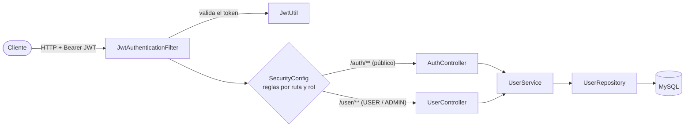

# SpringFirstAppJWT

API REST de usuarios con autenticación **JWT** y permisos por **rol**, hecha con Spring Boot 3 y Java 21.

[](https://openjdk.org/projects/jdk/21/)
[](https://spring.io/projects/spring-boot)
[](https://www.mysql.com/)
[](https://springdoc.org/)
[](LICENSE)

## Contenido

1. [Qué hace](#qué-hace)
2. [Cómo funciona](#cómo-funciona)
3. [Inicio rápido](#inicio-rápido)
4. [Configuración](#configuración)
5. [Usar la API](#usar-la-api)
6. [Roles](#roles)
7. [Estructura del código](#estructura-del-código)
8. [Pruebas](#pruebas)
9. [Licencia](#licencia)

## Qué hace

- Registra usuarios y emite un **token JWT** (HS256, 24 horas de vigencia) al iniciar sesión.
- Protege `/user/**` con ese token: algunos endpoints son de lectura para cualquier usuario autenticado y el resto son solo para administradores.
- Guarda las contraseñas con **BCrypt** y mantiene la API sin sesión (*stateless*).
- Publica la documentación en **Swagger UI**, con botón *Authorize* para probar con el token.

## Cómo funciona

Cada petición pasa primero por `JwtAuthenticationFilter`, que lee la cabecera `Authorization: Bearer <token>`, valida el token y carga al usuario desde la base de datos. Después, `SecurityConfig` decide por ruta y rol si la petición continúa.



## Inicio rápido

Necesitas **JDK 21+**, **Git** y un servidor **MySQL** con una base de datos vacía (Hibernate crea las tablas).

<details>
<summary>¿No tienes MySQL? Levántalo con Docker</summary>

```bash
docker run --name springfirstapp-mysql \
  -e MYSQL_ROOT_PASSWORD=cambia_esta_clave \
  -e MYSQL_DATABASE=springfirstapp \
  -p 3306:3306 -d mysql:8
```

Con eso, la URL de conexión es `jdbc:mysql://localhost:3306/springfirstapp` y el usuario es `root`.

</details>

```bash
# 1. Clonar
git clone https://github.com/P2X4A/SpringFirstAppJWT.git
cd SpringFirstAppJWT

# 2. Crear la configuración local (queda fuera de Git)
cp src/main/resources/application.properties.example src/main/resources/application.properties
#    En Windows (CMD): copy src\main\resources\application.properties.example src\main\resources\application.properties

# 3. Editar application.properties (base de datos y jwt.secret) y arrancar
./mvnw spring-boot:run          # Windows: mvnw.cmd spring-boot:run
```

Cuando arranque, abre **<http://localhost:8080/swagger-ui/index.html>**. La especificación OpenAPI está en `/v3/api-docs`.

## Configuración

`application.properties` está en `.gitignore` porque lleva credenciales. La plantilla `application.properties.example` trae todas las claves:

| Propiedad | Descripción |
|---|---|
| `spring.datasource.url` | URL JDBC de MySQL |
| `spring.datasource.username` / `password` | Credenciales de la base de datos |
| `spring.jpa.hibernate.ddl-auto` | `update`: crea y ajusta las tablas al arrancar |
| `server.port` | Puerto HTTP (8080 en la plantilla) |
| `jwt.secret` | Clave con la que se firman los tokens, **mínimo 32 caracteres** |

> **Importante:** define siempre `jwt.secret`. Si falta, `JwtUtil` usa un valor por defecto que está en este repositorio, y con él cualquiera podría generar tokens válidos.

## Usar la API

El recorrido típico es registrarse, iniciar sesión y usar el token:

```bash
# 1. Registrar
curl -X POST http://localhost:8080/auth/register \
  -H "Content-Type: application/json" \
  -d '{"username":"ana","password":"MiClave123"}'

# 2. Iniciar sesión -> {"token":"eyJhbGciOiJIUzI1NiJ9..."}
curl -X POST http://localhost:8080/auth/login \
  -H "Content-Type: application/json" \
  -d '{"username":"ana","password":"MiClave123"}'

# 3. Llamar a un endpoint protegido
curl http://localhost:8080/user/getall -H "Authorization: Bearer <TOKEN>"
```

### Públicos

| Método | Ruta | Respuestas |
|---|---|---|
| `POST` | `/auth/login` | `200` con el token · `401` credenciales inválidas |
| `POST` | `/auth/register` | `201` creado · `409` el usuario ya existe · `400` error |

### Con token: `USER` o `ADMIN`

| Método | Ruta | Respuestas |
|---|---|---|
| `GET` | `/user/getall` | `202` con la lista · `204` si está vacía |
| `GET` | `/user/count` | `202` con el total · `204` si es 0 |
| `GET` | `/user/exists/{id}` | `202` `true` · `204` `false` |
| `GET` | `/user/getbyid/{id}` | `202` con el usuario · `404` |

### Con token: solo `ADMIN`

| Método | Ruta | Respuestas |
|---|---|---|
| `POST` | `/user/createjson` (cuerpo JSON) | `201` · `406` · `400` si el nombre contiene `<` o `>` |
| `POST` | `/user/create?username=&password=` | `201` · `406` |
| `PUT` | `/user/updatejson?id=` (cuerpo JSON) | `202` · `226` nombre ya usado · `404` · `400` |
| `PUT` | `/user/update?id=&newUsername=&newPassword=` | `202` · `226` · `404` · `400` |
| `DELETE` | `/user/deletebyid/{id}` | `202` · `404` |
| `DELETE` | `/user/deletebyname?name=` | `202` · `404` |

## Roles

- Los usuarios creados por la API (`/auth/register` y `/user/create*`) reciben el rol `USER`; el cuerpo de la petición no permite elegir otro.
- Al arrancar, `LoadDatabase` crea el usuario `admin` si no existe (su contraseña inicial está en `LoadDatabase.java`) y, con el código actual, también con rol `USER`.
- Para habilitar los endpoints de `ADMIN`, promueve un usuario directamente en la base de datos:

```sql
UPDATE useraccount SET role = 'ADMIN' WHERE username = 'admin';
```

## Estructura del código

```text
src/main/java/co/edu/unbosque/springfirstapp/
├── SpringFirstAppApplication.java   arranque de Spring Boot
├── ServletInitializer.java          despliegue como WAR
├── configuration/                   LoadDatabase (usuario inicial) y OpenApiConfig (Swagger + bearerAuth)
├── controller/                      AuthController y UserController
├── dto/                             UserDTO y FactDTO
├── exception/                       PasswordNotValidException
├── model/                           User (implementa UserDetails) y enum Role { USER, ADMIN }
├── repository/                      UserRepository (Spring Data JPA)
├── security/                        SecurityConfig, JwtAuthenticationFilter, JwtUtil, UserDetailsServiceImpl
├── service/                         UserService, CRUDOperation y ExternalHTTPRequestHandler
└── util/                            AESUtil (cifrado AES y funciones hash)
```

Dos clases son utilidades independientes y no forman parte de la API REST: `AESUtil` (AES con Base64 y hashes MD5/SHA) y `ExternalHTTPRequestHandler` (ejemplo de `HttpClient` con Gson, con su propio `main`).

**Dependencias principales:** Spring Boot Starter (Web, Security, Data JPA, Validation), `jjwt` 0.11.5, `mysql-connector-j`, `springdoc-openapi` 2.3.0, ModelMapper 3.1.1, Gson y Apache Commons Codec. El proyecto se empaqueta como **WAR** y trae Maven Wrapper.

## Pruebas

```bash
./mvnw test
```

Hay una sola prueba, `SpringFirstAppApplicationTests`, que levanta el contexto de Spring; por eso necesita `application.properties` configurado y la base de datos disponible.

## Licencia

Distribuido bajo la **GNU General Public License v3.0**. El texto completo está en [LICENSE](LICENSE).
